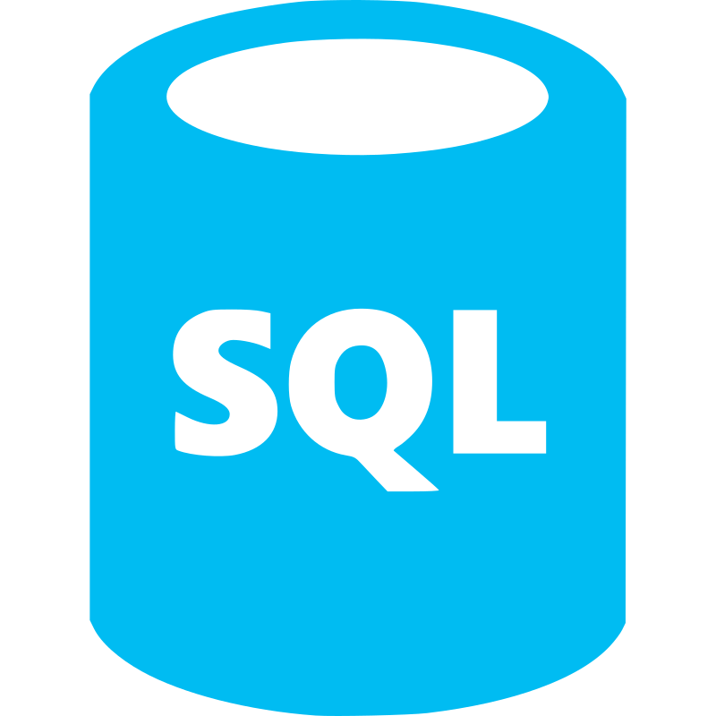
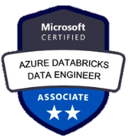
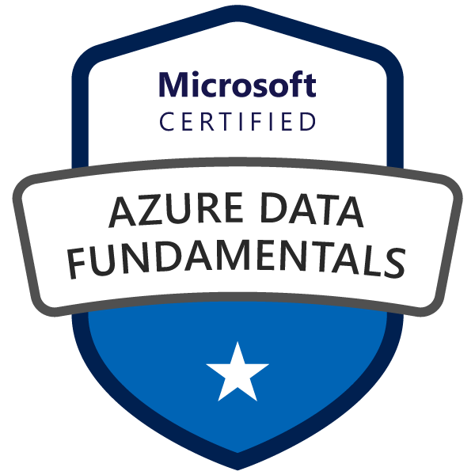
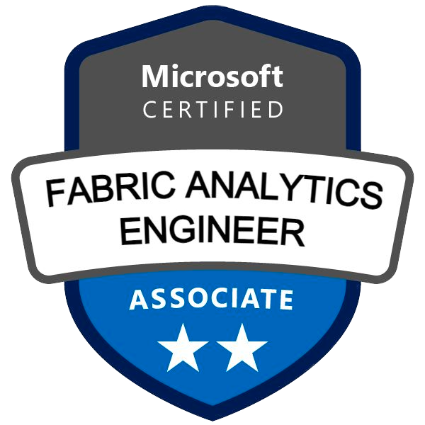
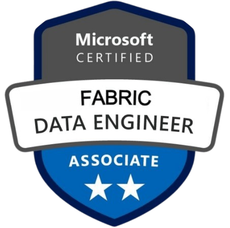
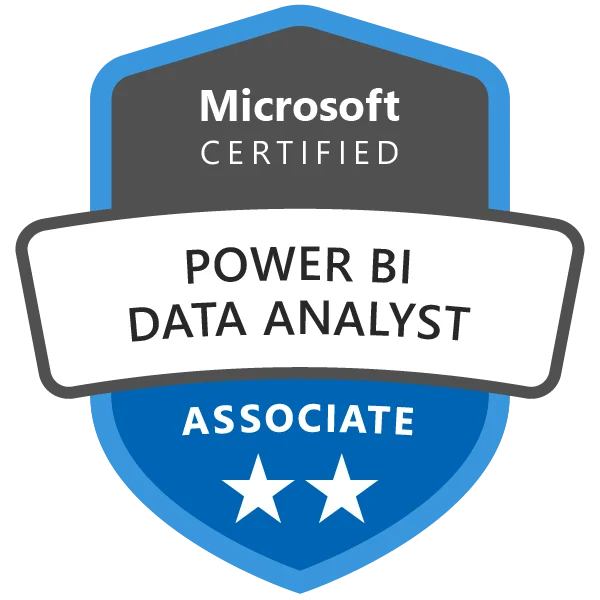
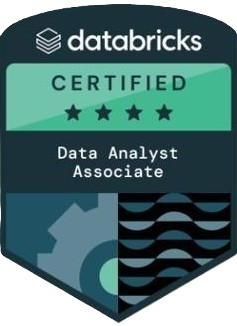
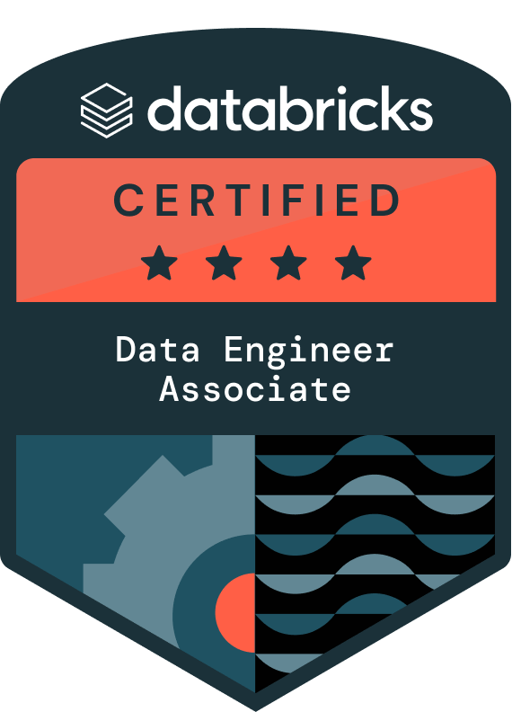
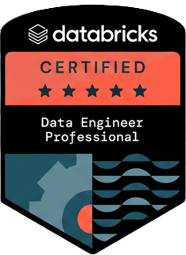
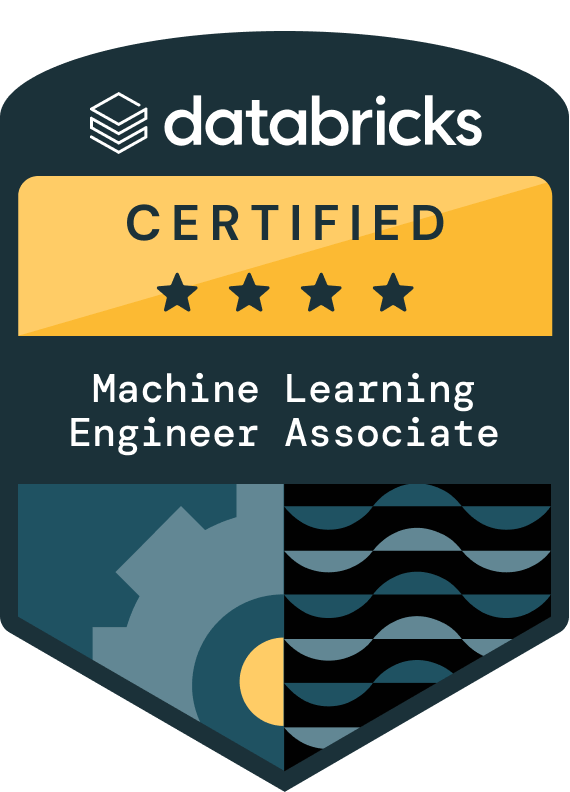

  
  

## 👋 About me

I'm a data and analytics engineer. I build data pipelines and turn raw data into clean datasets that people can use to make decisions.

I like designing scalable data architectures, writing ETL/ELT workflows, and building analytics solutions on top of them.

## 💡 What I do

- 🔧 **Data engineering:** ETL/ELT pipelines and data workflows
- 📊 **Analytics engineering:** clean, reliable, analytics-ready datasets
- 🏗️ **Data architecture:** data warehouses and modern data platforms
- 📈 **Data analytics:** turning complex data into business insights

## 🛠️ Tech stack

- **Languages:** Python, SQL, DAX
- **Data engineering:** Databricks, Fabric, Data Factory, Spark
- **Analytics engineering:** dbt, SQL, data modeling, Power BI
- **Cloud:** Azure
- **Tools:** Git, VS Code, Tabular Editor, Dax Studio
 
<table align="center">
  <tr>
    <td align="center" width="110"> Power BI</td>
    <td align="center" width="110"> Python</td>
    <td align="center" width="110"> Databricks</td>
    <td align="center" width="110"> SQL</td>
    <td align="center" width="110"> Fabric</td>
    <td align="center" width="110"> Azure</td>
    <td align="center" width="110"> Git</td>
  </tr>
</table>

## 🏅 Certifications

**Microsoft**

<table >
  <tr><td width="100"></td><td width="375">Azure Databricks Data Engineer Associate (DP-750)</td></tr>
  <tr><td></td><td>Azure Data Fundamentals (DP-900)            </td></tr>
  <tr><td></td><td>Fabric Analytics Engineer Associate (DP-600)</td></tr>
  <tr><td></td><td>Fabric Data Engineer Associate (DP-700)</td></tr>
  <tr><td width="60"></td><td>Power BI Data Analyst Associate (PL-300)</td></tr>
</table>

**Databricks**

<table width="300">
  <tr><td width="100"></td><td width="375">Databricks Data Analyst Associate</td></tr>
  <tr><td width="100"></td><td>Databricks Data Engineer Associate</td></tr>
  <tr><td width="100"></td><td>Databricks Data Engineer Professional</td></tr>
  <tr><td width="100"></td><td>Databricks Machine Learning Associate</td></tr>
</table>

## 🚀 Achievements

- 🚆 **Transport operator:** consolidated 40+ Power BI reports into one optimized semantic model, and cut data processing time by 60% by automating Databricks and Azure Data Factory pipelines
- 🎓 **Transport operator:** coached apprentices from onboarding to code review, bringing them up to speed on Power BI, SQL and Python
- ⚙️ **Internal projects:** designed Microsoft Fabric pipelines and Power BI dashboards, and prepared the clean data used to train and tune machine learning models
- 🛍️ **Luxury retail group:** delivered Power BI reports used by 150+ business users, and migrated 15+ Cognos reports to Power BI after validating the underlying datasets

## 🎯 Currently focused on

- Building scalable, efficient data pipelines
- Developing modern data platforms
- Improving data quality and observability
- Exploring cloud technologies and distributed data processing

## 🤝 Let's connect

I'm interested in data engineering, analytics, open source, and sharing what I learn with the tech community.

  

      

